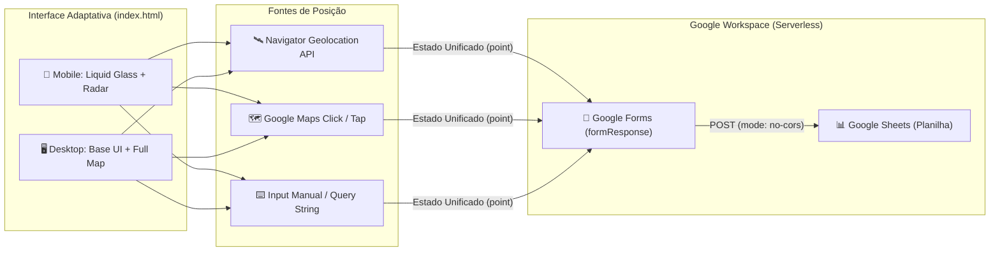

<div align="center">

# 🛰️ GenMet — Coleta de Dados Meteorológicos

**Interface geoespacial adaptativa (Single-File Web App) para captura de coordenadas de alta precisão e envio direto ao Google Forms / Google Sheets.**

[](#)
[](#)
[](#)
[](#)
[](#)

</div>

---

## 📖 Sobre o Projeto

O **GenMet** é uma aplicação web *zero-build* (100% contida em um único arquivo `index.html`) projetada para agilizar o registro de estações, pontos de coleta e observações meteorológicas em campo ou no escritório.

A aplicação combina a **Geolocation API** nativa do navegador com a **Google Maps JavaScript API** (com estilos cartográficos customizados) e utiliza o **Google Forms** como backend *serverless*, gravando cada coleta instantaneamente em uma planilha do Google Sheets sem necessidade de servidor próprio.

---

## ✨ Destaques & Experiência Dual-UI

Um dos grandes diferenciais do **GenMet** é sua arquitetura visual **Dual-Theme Adaptativa**, que entrega duas linguagens de design distintas e otimizadas conforme o dispositivo:

| Dispositivo | Breakpoint | Linguagem Visual | Recursos Exclusivos |
| :--- | :--- | :--- | :--- |
| 📱 **Mobile** | `< 960px` | **Liquid Glass Dark** | Superfícies translúcidas (`backdrop-filter: blur(28px) saturate(190%)`), bordas com máscara especular, reflexo dinâmico que acompanha o ponteiro/toque (`--mx`, `--my`), **Radar animando varredura e pulso de sinal**, e *Bottom Sheet* em tela cheia com mapa no tema **Dark** (`STYLE_DARK`). |
| 🖥️ **Desktop** | `>= 960px` | **Base Design System** | Estética editorial de alto contraste (Preto, Branco & Escala de Cinzas), cabeçalho fixo com *wordmark* e data por extenso, **mapa interativo em tela cheia** no tema **Light** (`STYLE_LIGHT`) com compensação inteligente de câmera (`offset: [-220, 0]`) ao lado do painel flutuante. |

---

## 🚀 Funcionalidades Principais

- **📍 Tripla Captura de Coordenadas:**
  1. **GPS de Alta Precisão (`gps`):** Captura via satélite/rede (`enableHighAccuracy: true`) com exibição do raio real de precisão em metros (`Circle` no mapa + badge de status).
  2. **Seleção Visual no Mapa (`map`):** Toque ou clique diretamente em qualquer ponto do mapa para posicionar o pino customizado (`PinOverlay`).
  3. **Entrada Manual (`manual`):** Digitação direta de Latitude e Longitude com validação automática (`-90..90` / `-180..180`), *debounce* de `500ms` e sincronização instantânea com o marcador no mapa.
- **🔗 Pré-preenchimento via URL (Deep Linking):**
  - Suporte nativo a parâmetros de Query String para automação, QR Codes de estações fixas ou links compartilháveis:
    ```text
    https://seu-usuario.github.io/genmet/?local=Estacao%20Campinas&lat=-22.905600&lng=-47.060800
    ```
- **⏱️ Relógio & Telemetria em Tempo Real:**
  - Display tipográfico com números tabulares (`tabular-nums`), atualização a cada segundo e formatação localizada em `pt-BR`.
  - Indicador visual de estado (`idle`, `seeking`, `locked`, `error`) sincronizado entre o LED de status e o radar.
- **🛡️ Resiliência & Fallback Gracioso:**
  - Caso a chave da API do Google Maps não esteja configurada, esteja restrita ou o dispositivo esteja com conexão instável para carregar tiles, a interface exibe um *grid* cartográfico de fallback e mantém a captura via GPS e digitação manual 100% operacionais.
- **♿ Acessibilidade & Performance:**
  - Suporte completo a `prefers-reduced-motion: reduce`, navegação por teclado (`Escape` fecha o modal do mapa com *rollback* de estado se não confirmado), atributos `aria-live="polite"` e zero dependências externas de CSS/JS além das fontes e da API do mapa.

---

## 🧭 Arquitetura e Fluxo de Dados



---

## 🛠️ Como Configurar e Executar

Como o projeto é um **Single-File Web App**, não há etapa de `npm install` ou *build*. Basta abrir ou hospedar o arquivo `index.html`.

### 1. Clonar o repositório
```bash
git clone https://github.com/SEU-USUARIO/SEU-REPOSITORIO.git
cd SEU-REPOSITORIO
```

### 2. Configurar a chave do Google Maps
No arquivo `index.html` (por volta da linha `829`), insira sua chave da **Maps JavaScript API**:

```javascript
const GOOGLE_MAPS_API_KEY = 'SUA_CHAVE_GOOGLE_MAPS_AQUI';
```
> **Dica de Segurança:** No [Google Cloud Console](https://console.cloud.google.com/), restrinja sua chave por **Referenciadores HTTP (sites)** permitindo apenas o seu domínio (ex.: `https://seu-usuario.github.io/*`).

### 3. Configurar o Endpoint do Google Forms
O formulário envia os dados via `POST` (`mode: 'no-cors'`) para o endpoint configurado na constante `FORM_ACTION_URL` (linha `831`):

```javascript
const FORM_ACTION_URL = 'https://docs.google.com/forms/d/e/SEU_FORM_ID/formResponse';
```

Os campos do `<form id="customGoogleForm">` estão mapeados para os seguintes `entry IDs`:

| Campo na Interface | Atributo `id` | Atributo `name` (Google Forms) | Exemplo de Valor |
| :--- | :--- | :--- | :--- |
| **Local** | `#local` | `entry.1350129950` | `Estação Centro` |
| **Latitude** | `#latitude` | `entry.718109587` | `-22.905600` |
| **Longitude** | `#longitude` | `entry.964245664` | `-47.060800` |

### 4. Executar Localmente
> ⚠️ **Importante:** A API de Geolocalização dos navegadores modernos exige contexto seguro (`HTTPS` ou `http://localhost`). Evite abrir via `file://` se quiser testar o GPS real.

Você pode subir um servidor local rápido com Python ou Node.js:

```bash
# Com Python 3
python -m http.server 8080

# Ou com Node.js (npx)
npx serve .
```
Depois, acesse `http://localhost:8080` no navegador.

---

## 🌐 Deploy no GitHub Pages

1. Suba o arquivo `index.html` na branch `main` do seu repositório no GitHub.
2. No GitHub, acesse **Settings** → **Pages**.
3. Em **Build and deployment**, selecione **Deploy from a branch** e escolha `main` / `/ (root)`.
4. Salve. Em poucos segundos, seu sistema **GenMet** estará online com `HTTPS` ativo (habilitando o GPS em smartphones).

---

## 🎨 Especificações Técnicas de Design

- **Tipografia:**
  - Mobile: [`Bricolage Grotesque`](https://fonts.google.com/specimen/Bricolage+Grotesque) (com suporte a optical sizing `opsz 96` no relógio principal).
  - Desktop: [`Inter`](https://fonts.google.com/specimen/Inter) (com `font-feature-settings: "cv11", "ss01"` e `tabular-nums`).
- **Coordenada Central Padrão:** Campinas, SP (`lat: -22.9056, lng: -47.0608`).
- **Overlay Customizado:** Implementação própria da classe `PinOverlay` estendendo `google.maps.OverlayView`, permitindo renderizar marcadores HTML/CSS com halo pulsante, rótulo dinâmico do nome do local e precisão em metros.

---

<div align="center">
  <sub>Desenvolvido para coleta ágil e precisa de dados meteorológicos.</sub>
</div>
